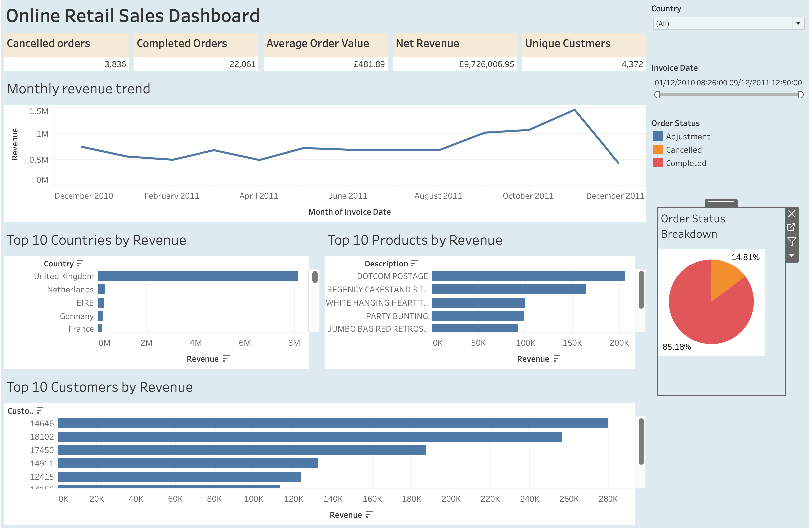
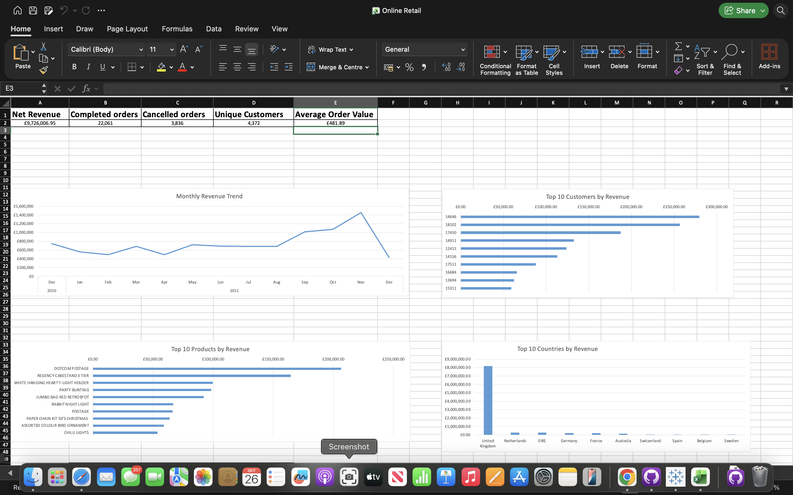
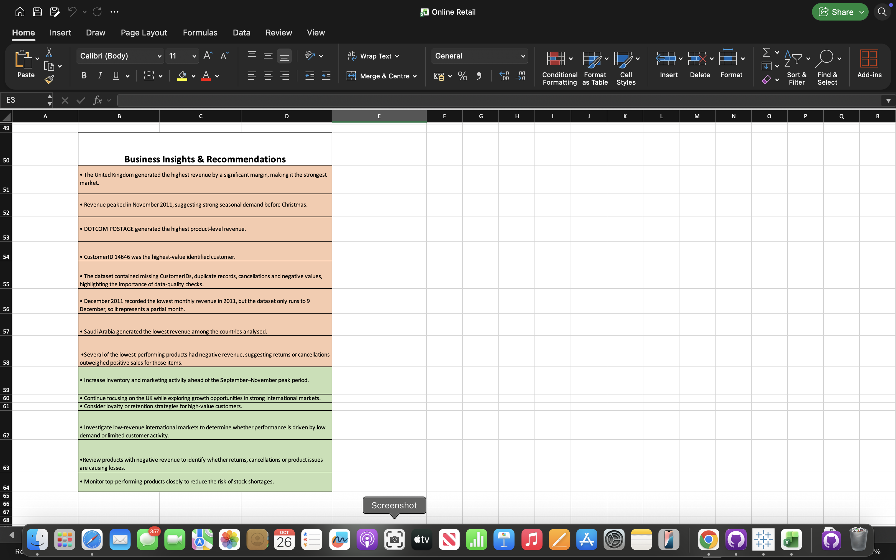

# Online Retail Data Analysis | Excel & Tableau

## Project Overview

This project analyzes an online retail dataset to identify sales trends, customer purchasing behavior, and business performance.

The aim is to transform raw transactional data into meaningful insights that can support business decision-making.

**Tools used:** Microsoft Excel and Tableau

## Project Objectives

- Analyze overall sales performance and revenue trends.
- Identify the best-selling and lowest-performing products.
- Explore customer purchasing behavior.
- Compare sales performance across different countries.
- Build an interactive dashboard to communicate findings.

## Data Cleaning and Preparation

Microsoft Excel was used to prepare the dataset for analysis.

Key tasks included:

- Identifying and removing duplicate records.
- Identifying canceled transactions.
- Reviewing data quality and consistency.
- Preparing the dataset for KPI calculations and visualizations.

## Key Performance Indicators (KPIs)

The following metrics were analyzed:

- **Total Revenue:** Overall sales revenue.
- **Total Orders:** Number of unique orders.
- **Average Order Value:** Average revenue generated per order.

## Data Analysis and Visualizations

The analysis explored:

1. Monthly revenue trends.
2. Top 10 revenue-generating products.
3. Bottom 10 performing products.
4. Sales revenue by country.
5. Revenue generated by individual customers.
6. Invoice and order distribution.

Excel was used for data preparation and analysis, while Tableau was used to create interactive visualizations.

## Key Findings

- The United Kingdom represented the largest share of sales revenue.
- Comparing countries without the UK provided a clearer view of international sales performance.
- Product-level analysis helped identify both high-performing and low-performing items.
- Monthly sales analysis helped highlight changes in revenue over time.

## Business Recommendations

- Investigate the factors driving sales of top-performing products.
- Review low-performing products to identify opportunities for improvement.
- Monitor monthly revenue trends to support inventory and sales planning.
- Explore opportunities to increase sales in international markets.
- Use customer purchasing patterns to support targeted marketing strategies.

## Interactive Tableau Dashboard

Explore the interactive dashboard published on Tableau Public.

[**View Interactive Tableau Dashboard**](https://public.tableau.com/app/profile/nicolas.louis.goodluck/viz/OnlineRetail_17928587761920/Dashboard)

## Dashboard Screenshots

### Tableau Dashboard

### Excel Dashboard

### Business Insights and Recommendations

## Project Files

- `Online Retail.xlsx` — Excel workbook containing the retail data and analysis.
- `README.md` — Project documentation.

## Skills Demonstrated

- Data cleaning and validation
- Microsoft Excel
- KPI development
- Exploratory data analysis
- Tableau dashboard development
- Data visualization
- Business insights and recommendations

## Conclusion

This project demonstrates an end-to-end data analysis workflow, from preparing transactional data in Excel to analyzing business performance and presenting findings through an interactive Tableau dashboard.
